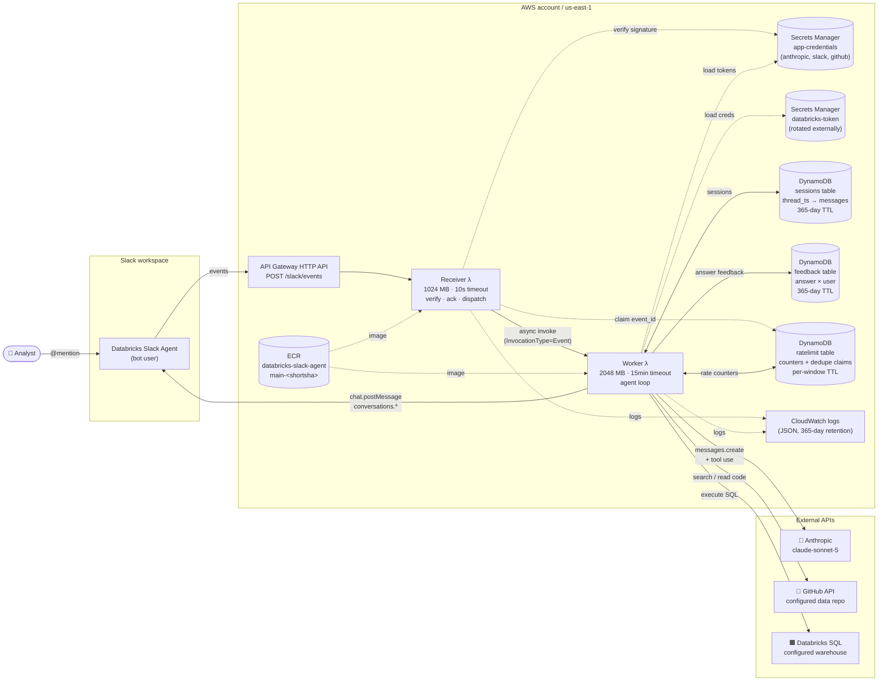
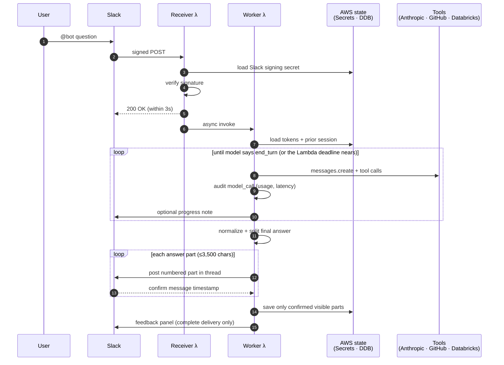
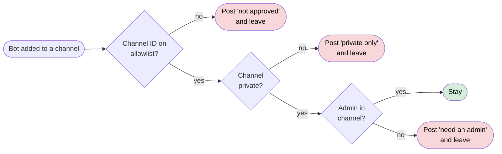
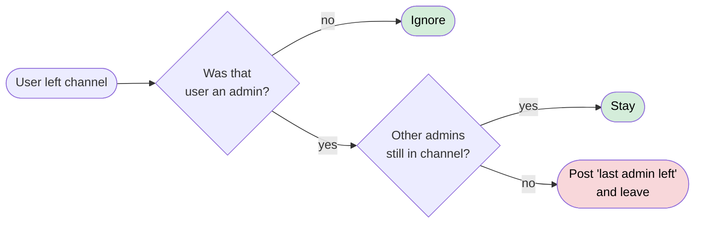
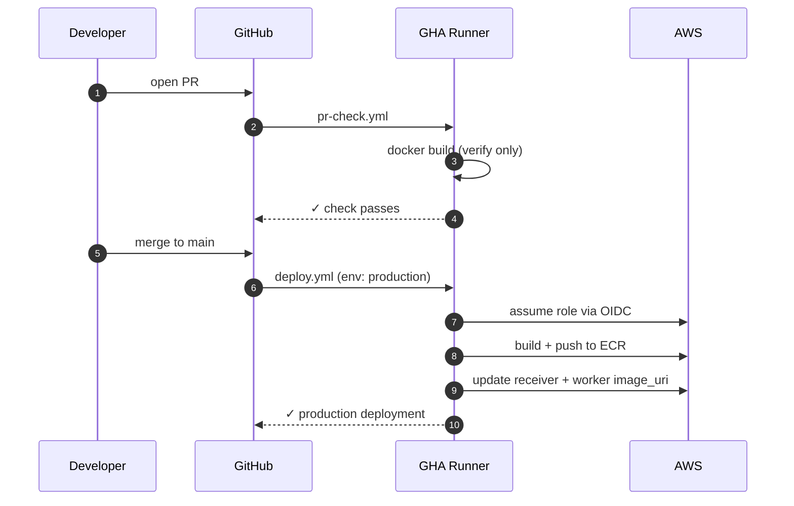

# databricks-slack-agent

A Slack bot that answers data-model, SQL, lineage, and metric questions by
querying **Databricks** (Unity Catalog and the SQL Statement Execution API) and a
**GitHub** data repository. It runs as two AWS Lambda functions behind an API
Gateway endpoint, calls an LLM (Anthropic by default, OpenAI optional) in a manual
agent loop, and ships with the guardrails a data-facing bot needs: read-only SQL
validation, numeric-grounding checks, per-user rate limits, a channel/admin
allowlist, and button-confirmed job triggering.

> **Example data.** The `prompts/business/` folder, the eval fixtures, and the
> test data describe a **fictional online shop ("Acme Shop")** so the bot has
> realistic grounding to demonstrate. Replace them with your own before
> deploying; see [`docs/SETUP.md`](docs/SETUP.md). The repository ships without a
> recorded evaluation baseline; see [`evals/README.md`](evals/README.md).

> **Want to deploy it?** The reusable Terraform under
> [`infrastructure/`](infrastructure/) creates the complete AWS runtime. See
> [`docs/SETUP.md`](docs/SETUP.md) for the end-to-end walkthrough, and
> [`docs/USAGE.md`](docs/USAGE.md) for example questions, conversation tips, and
> operating limits.

## Architecture

Two Lambda functions sharing one container image. `ImageConfig.Command` selects the handler at function level (`receiver.lambda_handler` for the receiver, `worker.lambda_handler` for the worker). Receiver does sub-100ms work (signature check, one DynamoDB dedupe claim, async invoke); worker does the heavy lifting.

### Runtime components



### Runtime: @-mention flow

What happens between the user typing `@Databricks Slack Agent` and seeing a reply.



Receiver is light by design — it verifies the Slack signature, claims the delivery's `event_id` with one conditional DynamoDB `UpdateItem` (so Slack redeliveries are processed at most once, and a redelivery whose original was lost still gets through), returns 200 fast, and async-fires the worker. If the async invoke fails the claim is released so the next Slack retry is handled. Worker handles everything slow (Anthropic, tool calls, posting). Secrets and the prior session are loaded once at the top of the worker run; tokens stay cached for ~5 minutes inside a warm container. The worker reads its remaining Lambda time at the start of every invocation and stops the agent loop gracefully (user-visible note, session saved) before the hard timeout. A main-thread real-time alarm interrupts model SDK retries and streaming at the reserved invocation deadline; per-socket timeouts alone do not provide that total bound.

If Slack does not confirm a part, the worker stops posting later parts, marks
delivery as incomplete in the status/audit trail, persists only parts the user
actually received, and suppresses the feedback panel.

### Runtime: channel access guard

Three independent checks must all pass for the bot to operate in a channel — each one fails closed:

1. **Channel ID is in [`config/allowed_channels.json`](config/allowed_channels.json)** — PR-reviewed allowlist of explicit channel IDs.
2. **Channel is private** — verified at runtime via `conversations.info`; an unverifiable channel is treated as not-private.
3. **At least one allowlisted admin (in [`config/admins.json`](config/admins.json)) is a member** — original guard, kept as defense-in-depth.

The guard fires on `member_joined_channel` (when the bot itself is added — leaves immediately if any check fails) and on `member_left_channel` (re-checks admin presence; leaves if the last admin departs). `app_mention` re-validates all three checks on every message so a channel removed from the allowlist while the bot is still inside stops responding immediately. If the member list cannot be fetched on a mention, the bot fails closed by not answering (audit reason `admin_unverifiable`) but does not leave on what may be a transient Slack error.

**When the bot is added to a channel** (`member_joined_channel`):



**When someone leaves a channel the bot is in** (`member_left_channel`):



### Deploy flow

PR-driven; merge to `main` is the only thing that ships code.



The build runs once on PR (no AWS access — just verifies the image compiles) and once on merge (with full deploy permissions via OIDC). Warm Lambda containers are invalidated automatically once the new image is set; the next invocation cold-starts on the new code.

## Model & agent loop

- **Model**: `claude-sonnet-5` by default (1M context, adaptive thinking, `effort: high`), the default configuration. The code, the eval gate and the Terraform module all default to the same model so a fork or CI run evaluates what is deployed. Model, effort (`low` / `medium` / `high` / `xhigh` / `max`; `xhigh` maps to `max` on models without it), and `max_tokens` are read from `ANTHROPIC_MODEL`, `ANTHROPIC_EFFORT`, and `ANTHROPIC_MAX_TOKENS` so a change is a Terraform variable change, not a code deploy. Change one knob at a time and compare the usage/latency events below before and after.
- **Output cap**: `ANTHROPIC_MAX_TOKENS` always wins when set (Terraform sets it; module default 24000). When it is unset, the worker uses `recommended_max_tokens(model, effort)` from `utils/llm/anthropic_provider.py` — Sonnet 5 / Opus 5: 24000 up to `high`, 48000 at `xhigh`, 64000 at `max`; Sonnet 4.6: 16000 up to `high`, 32000 at `max`; unknown models 16000 — so the default `claude-sonnet-5` / `high` resolves to 24000 with or without the variable, and logs `max_tokens=<n> (source=…)` once at startup. `claude-sonnet-4-6` (any snapshot) is pinned to exactly 16000 when the variable is unset so its measurements stay comparable; `worker.DEFAULT_MAX_TOKENS` (16000) is the hard floor for invalid values and unknown models.
- **Transport**: `ANTHROPIC_STREAM` = `auto` (default) / `always` / `never`. `auto` streams (`client.messages.stream(**kwargs)` + `get_final_message()`) only when `max_tokens > 21000`, just under the point where the SDK refuses a non-streaming request; the kwargs, response object, usage and `model_call` audit are identical either way. At the production cap of 24000 the worker (and the eval runner) therefore stream; a 16000-token Sonnet 4.6 request keeps using `messages.create`.
- **Provider**: the loop calls the model through `utils/llm/` (see [docs/PROVIDERS.md](docs/PROVIDERS.md)). `LLM_PROVIDER` selects `anthropic` (default) or `openai`; `LLM_MODEL` overrides the model for either provider; `OPENAI_MODEL` (default `gpt-5.6-terra`) is the OpenAI counterpart of `ANTHROPIC_MODEL`. The Anthropic provider sends exactly the request the worker sent before the abstraction existed (same `system` block with `cache_control`, `thinking: adaptive`, `output_config.effort`, `input_schema` tools, bounded SDK timeout), so measurements stay comparable. The OpenAI Responses translation is implemented and tested but **not enabled**: it needs the `openai` package in the image, an `openai_api_key` entry in the app secret, and `llm_provider = "openai"`. Until then selecting it raises `ProviderNotConfigured`. `model_call` and `run_summary` audit events carry `provider`.
- **Stored format**: sessions stay in the Anthropic block format regardless of provider. Non-Anthropic providers may append a `{"type": "provider_reasoning", "provider": "openai", "payload": {…}}` block to assistant turns to replay opaque reasoning across turns; the Anthropic provider strips it before sending, compaction drops it from previous runs, and every guard/renderer skips it.
- **Loop**: manual request loop (not an agent-runner SDK), so we can post progress updates between iterations. Each request carries a timeout (`ANTHROPIC_TIMEOUT_SECONDS`, default 180 s) clamped to the remaining Lambda time; the loop refuses to start another iteration with less than `AGENT_MIN_SECONDS_PER_ITERATION` (default 90 s) left and instead posts "I ran out of time" and saves the session.
- **Stop reasons**: `end_turn` delivers the answer; `max_tokens` delivers whatever text was produced with a "cut off" note (no SQL attachment or feedback panel) or, if nothing usable was produced, a short notice; `refusal` posts a neutral reply and is not saved; `pause_turn` continues automatically. Providers normalize their own statuses onto these (table in `docs/PROVIDERS.md`).
- **Measurement**: every model request emits a `model_call` audit event (`provider`, `model`, `effort`, `latency_ms`, `stop_reason`, `input_tokens`, `cache_creation_input_tokens`, `cache_read_input_tokens`, `output_tokens`) and every run ends with a `run_summary` (totals, `api_calls`, `tool_calls`, `outcome`, `provider`). `scripts/export_sessions.py` aggregates these into `model_usage_report.md` (cost per run, cache hit rate, latency percentiles per model and effort). See [Measuring the model](#measuring-the-model).
- **System prompt**: assembled by `utils/system_prompt.py` from a directory of focused files. The layout splits **generic** behavior from **business-specific** knowledge so another team can repurpose the bot by replacing one folder:
  - `prompts/core/00_behavior.md` — generic tool/SQL rules, communication style, Slack formatting
  - `prompts/core/workflows/*.md` — one file per workflow procedure (RCA, diff mode, change tracking, lineage, metric definitions, SQL generation, query comparison, job triggering)
  - `prompts/business/00_repo_context.md` — **example** (fictional Acme Shop) catalog map, history tables, object-type verification, job-triggering capability
  - `prompts/business/01_glossary.md` — **example** glossary, known data events, and masked-column notes
  - `prompts/providers/<provider>.md` — provider-specific style notes, appended **last** via `load_system_prompt(provider)`. `anthropic.md` is comment-only (appends nothing) so the deployed Claude prompt is byte-identical to the pre-provider layout; `openai.md` adds a short function-calling/formatting section. Core and business files stay provider-neutral.
  - Files load in this order (core, then business, then provider — sorted within each), so the cache prefix stays stable across business-knowledge churn.
- **Caching**: two explicit `cache_control: ephemeral` (5-minute) breakpoints per request, both placed by `utils/llm/anthropic_provider.py`. (1) The assembled system prompt — tools render before `system`, so this one marker caches tools + system together. (2) A *moving* marker on the last content block of the last message (the newest `tool_result` inside a run; the user's text on the first call, which is why a string user message is sent as a single `text` block), so each iteration of the agent loop reads the whole prefix the previous iteration wrote and writes only the newly appended turn. Two rules keep that prefix byte-stable: `_prepare_messages_for_api` never strips `thinking` blocks from assistant turns of the *current* run (stripping iteration N's thinking on iteration N+1 rewrites that turn and invalidates everything after it — that, plus the missing tail breakpoint, is why production showed a constant `cache_read_input_tokens` and `cache_creation_input_tokens: 0`), and prior-run history is compacted identically on every call of a run, including the previous run's final assistant turn — its `thinking` is stripped from the run's first call onward, not only once the current run has an assistant turn of its own, so the prior-run prefix is not rewritten between call 1 and call 2 of a follow-up. The marker is written to a copy; the stored session never contains `cache_control`. A new user turn recompacts the previous run (thinking stripped, tool results compacted), so cross-turn reuse covers only the system prompt and older runs; at ~2 conversations/day the 1-hour TTL (2× write price) would rarely be read back, so the 5-minute TTL stays. Verify from `model_call` events: within a run `cache_read_input_tokens` should grow call over call, `cache_creation_input_tokens` should be roughly one iteration's worth (previous assistant output + new tool results), and `input_tokens` should be small; a constant `cache_read_input_tokens` with zero writes means the tail is no longer cacheable — diff two adjacent requests' `messages` (markers excluded) to find the rewrite. (OpenAI has no explicit marker; the Responses translation drops `cache_control` and its automatic caching keys on the same stable prefix.)

## Tools

### GitHub (scoped to the repository in `GITHUB_REPO`, `ref=main`)
- `github_find_files` — typed filename/path discovery without code-search syntax
- `github_search_code` — returns `truncated: true` when GitHub's `total_count` exceeds the returned page
- `github_get_file_content` — reads up to 60,000 characters from the selected file and marks truncation explicitly; filename discovery does not further limit this tool
- `github_get_commits`
- `github_compare_commits` — `truncated: true` when the diff hits GitHub's 300-file cap

Model-supplied `path`, `base`, `head`, and `ref` values are validated and percent-encoded before they reach a URL (no `..` segments, `?`, `#`, or leading `/`), and `ref` is always sent as a query parameter, so the repo/branch scope is enforced in code rather than by convention. GitHub requests share the Databricks retry policy (three attempts on timeouts, connection errors, and 5xx), wait once on a rate-limit `Retry-After`, refresh the cached token once on 401, and return a structured `{"error", "status_code", "rate_limited"}` result rather than raising.

### Databricks

**Read tools** (run on the SQL warehouse named by `DATABRICKS_WAREHOUSE_ID`; a serverless warehouse gives the fastest cold start):
- `databricks_find_objects` — exact or partial table/view name discovery through `system.information_schema`
- `databricks_describe_object` — typed columns and comments for one exact object
- `databricks_execute_sql` — internal poll up to ~90s or until the invocation deadline budget is nearly used, whichever comes first; returns `statement_id` if still running
- `databricks_get_statement` — retrieve results for a previously submitted long-running query

**Job tools** (use the Databricks Jobs REST API, no warehouse needed):
- `databricks_run_job(job_id, [notebook_params])` — request confirmation for an approved existing job. For DAB jobs, the bot reads `resources/jobs/` for current configuration and resolves the live ID from the workspace job ledger; UI-managed jobs are resolved from the ledger and runbooks. The tool requests a shared Confirm run button; it cannot directly launch a job. Any current channel member can confirm once within 10 minutes. A conditional DynamoDB claim binds the approval to the exact job, parameters, channel, thread, and message. The shared card names the confirmer and removes its button. The handler checks live job eligibility and rejects configuration changes before launch.
- `databricks_get_run_status(run_id)` — check on a triggered run (life_cycle_state, result_state, durations, run page URL)
- `databricks_cancel_run(run_id)` — cancel an in-progress run; no confirmation needed when the target run is unambiguous (corrective action; the prompt asks which run only when the thread has several candidates)
- `databricks_get_recent_runs(job_id, limit)` — recent completed runs with a median/min/max duration summary; used to give the user a duration estimate in the trigger confirmation prompt and post-trigger response
- `databricks_list_job_runs([date], [active_only], [limit])` — list workspace-visible job runs for a New York calendar date through the Jobs API; used for “what ran today?” without guessing SQL system-table schemas


### Calculator

- `calculate(expression, [variables], [precision])` — deterministic arithmetic on numbers the model already has (differences, percent change, ratios, averages, durations, unit conversions). Expressions are parsed with `ast` and evaluated by a whitelist walker on `Decimal` (no `eval`); only numeric literals, bound `variables`, `+ - * / // % **`, parentheses, and a fixed function table (`abs`, `round`, `min`, `max`, `sum`, `avg`, `median`, `sqrt`, `floor`, `ceil`, `pct`, `pct_change`, `days_between`, `hours_between`, `minutes_between`) are accepted. Success returns `{"expression", "variables", "result", "result_display", "steps"}`; a bad expression or division by zero returns `{"error", "validation_failure"}` and is classified as a `guard_precondition` outcome, not a tool failure. It needs no warehouse or network and is not subject to the SQL guard's metadata preflight. The system prompt requires the model to use it (or a SQL aggregate) for every derived number and to quote `result_display` verbatim; see [Numeric grounding](#reliability-notes).

### Service Principal permissions

The Databricks Service Principal is constrained at the source — these are the actual security boundaries, enforced by Databricks regardless of what the bot tries:

| Surface | What the SP can do |
|---|---|
| Data | **Read-only.** `SELECT` / `SHOW` / `DESCRIBE` / `EXPLAIN` only. Destructive SQL is rejected. |
| Jobs | `data-assistant-sp` (`00000000-0000-4000-8000-000000000001`) has `CAN_MANAGE_RUN` on an **approved subset of bundle-managed `[DAB]` jobs**. The permission is declared in each approved resource YAML. Can trigger / cancel runs. **Cannot** edit, create, pause, unpause, or delete jobs. Retired `PAUSED_USE_BUNDLE_VERSION_*` originals are not valid trigger targets. |

Job confirmation is enforced in code. The model can only prepare a button; a signed Slack interaction from a current member of an approved private channel claims the action once. Jobs must have an explicitly unpaused schedule, continuous mode, or trigger, and Git-backed jobs must use main. Configuration is checked again at confirmation. The approval ID is reused as the Databricks idempotency token across HTTP retries. Approval rows use the existing rate-limit table and UpdateItem permission; no infrastructure migration is needed. If a launch response is uncertain, the button remains consumed and the shared reply instructs users to check recent runs before requesting another launch.

## Required Lambda env vars

All sensitive credentials live in **AWS Secrets Manager**, not env vars. The Lambdas only need pointers (ARNs) to those secrets plus a couple of bookkeeping values.

The consolidated app secret referenced by `APP_SECRET_ARN` must contain:

```json
{
  "anthropic_api_key": "sk-ant-...",
  "slack_bot_token": "xoxb-...",
  "slack_signing_secret": "...",
  "github_token": "github_pat_..."
}
```

**Receiver (`databricks-slack-agent-receiver`):**

| Variable | Required? | Notes |
|---|---|---|
| `APP_SECRET_ARN` | Yes | ARN of the consolidated app-credentials secret. Receiver reads `slack_bot_token` (lazy slack client init) and `slack_signing_secret` (HMAC verification). |
| `WORKER_FUNCTION_NAME` | No | Defaults to `databricks-slack-agent-worker`. Override to match your fork's `APP_NAME-worker`. |
| `RATELIMIT_TABLE_NAME` | No | Defaults to `databricks-slack-agent-ratelimit`. The receiver uses the same table for Slack `event_id` dedupe (conditional `UpdateItem`), so its role needs `dynamodb:UpdateItem` on it. |

**Worker (`databricks-slack-agent-worker`):**

| Variable | Required? | Notes |
|---|---|---|
| `APP_SECRET_ARN` | Yes | ARN of the consolidated app-credentials secret. Worker reads all four keys above. |
| `DATABRICKS_SECRET_ARN` | Yes | ARN of a separate Secrets Manager secret containing `{ "host": "...", "token": "dapi..." }`. Worker fetches it on first use and caches for 5 min in the warm container; on a 401 from Databricks the cache is invalidated and the request retried once. Kept separate from the app secret because the Databricks Service Principal is typically provisioned and rotated by separate IaC — a new PAT lands in this secret every ~30 days and the bot picks it up on the next 5-min cache refresh, no app changes needed. |
| `GITHUB_REPO` | Yes in practice | Defaults to the placeholder `example-org/example-data-repo`. Set to your data-warehouse repo (`<owner>/<name>`). Terraform sets it from `data_github_repository`. |
| `GITHUB_DEFAULT_REF` | No | Defaults to `main`. Override if your repo uses a different default branch. |
| `DATABRICKS_WAREHOUSE_ID` | Yes | No default: SQL tools return a configuration error until it is set. The SP whose PAT is in `DATABRICKS_SECRET_ARN` must have `CAN_USE` on the warehouse. |
| `SESSIONS_TABLE_NAME` | No | Defaults to `databricks-slack-agent-sessions`. Override to match your fork's session-storage DDB table. |
| `FEEDBACK_TABLE_NAME` | No | Defaults to `databricks-slack-agent-feedback`. Stores each Slack user's latest rating for an answer. |
| `RATELIMIT_TABLE_NAME` | No | Defaults to `databricks-slack-agent-ratelimit`. Atomic per-user / per-channel / global counters (see [Rate limiting](#rate-limiting)). |
| `RATELIMIT_USER_PER_HOUR`, `RATELIMIT_USER_PER_DAY`, `RATELIMIT_CHANNEL_PER_HOUR`, `RATELIMIT_SQL_PER_DAY` | No | Counter ceilings; defaults 60 / 200 / 200 / 500. See [Rate limiting](#rate-limiting). |
| `LLM_PROVIDER` | No | Defaults to `anthropic`. `openai` selects the Responses API provider, which additionally requires the `openai` package and an `openai_api_key` in the app secret (see [docs/PROVIDERS.md](docs/PROVIDERS.md)). Unknown values fail at startup. |
| `LLM_MODEL` | No | Unset by default. Provider-neutral model override; wins over `ANTHROPIC_MODEL` / `OPENAI_MODEL` when set. |
| `ANTHROPIC_MODEL` | No | Defaults to `claude-sonnet-5`. Model ID used when the provider is `anthropic`. |
| `OPENAI_MODEL` | No | Defaults to `gpt-5.6-terra`. Model ID used when the provider is `openai`. |
| `ANTHROPIC_EFFORT` | No | Defaults to `high`. Reasoning effort for either provider (`low` / `medium` / `high` / `xhigh` / `max`; `xhigh` maps to `max` on models that lack it). |
| `ANTHROPIC_MAX_TOKENS` | No | Terraform sets `24000` (the `recommended_max_tokens` value for `claude-sonnet-5` at `high`). Output-token cap per model call (the OpenAI provider raises it to at least 25,000 because that cap also covers reasoning). When unset, the worker uses `recommended_max_tokens(model, effort)` — 24000 for the default model — except `claude-sonnet-4-6`, which stays at the 16000 floor (see [Model & agent loop](#model--agent-loop)). |
| `ANTHROPIC_STREAM` | No | Defaults to `auto`: stream the Messages request only when `max_tokens` exceeds 21000 (the SDK refuses larger non-streaming requests). `always` / `never` force a transport. Response shape and audit fields are identical in both modes. |
| `ANTHROPIC_TIMEOUT_SECONDS` | No | Defaults to `180`. Per-request Anthropic client timeout; keep well under the worker's Lambda timeout. |
| `ANTHROPIC_MAX_RETRIES` | No | Defaults to `5`. SDK retries for transient Anthropic failures (see [SQL execution](#sql-execution)). |
| `AGENT_MIN_SECONDS_PER_ITERATION` | No | Defaults to `90`. Minimum remaining Lambda time required before the worker starts another model/tool iteration; below this it wraps up instead of risking a mid-turn timeout. |
| `NUMERIC_GUARD_MODE` | No | Defaults to `revise`. `revise` asks the model for a private revision when the final answer contains figures no tool returned, then footnotes any that remain; `annotate` skips the revision and only footnotes; `off` disables the check. See [Numeric grounding](#reliability-notes). |
| `NUMERIC_GUARD_MAX_REVISIONS` | No | Defaults to `1`. Private revision passes the numeric guard may request per run before falling back to the footnote. Each pass costs one model call and counts against `MAX_ITERATIONS`. |

The Terraform module in [`infrastructure/`](infrastructure/) exposes every one of these as a variable and maps it into the worker `environment`.

Secrets-Manager-fetched values are cached in-memory for ~5 min within a warm container. After a manual rotation in Secrets Manager, expect up to a 5-minute delay before the new values are picked up (or eject the warm container by editing the Lambda config and re-saving).

## Deployment

PR-based, with deploy on merge to `main`. No manual tagging or workflow dispatches.

```
feature branch  ─▶  PR to main  ─▶  pr-check.yml: unit tests → conversation evals
                                            │       → Docker build → Terraform validate
                                  merge ────▼
                                  deploy.yml: unit tests
                                            → build → push to ECR (tagged `main-<shortsha>`)
                                            → update-function-code on receiver + worker
                                            → wait + verify State/LastUpdateStatus/ImageUri
```

Two workflows (all third-party actions pinned to commit SHAs; Dependabot keeps
them, `uv.lock`, and the Lambda base-image digest current — the Python minor is
pinned to 3.12 deliberately, so only digest refreshes arrive for the image):

- **`pr-check.yml`** — on every PR to `main`: `Unit tests` (`uv sync --locked`
  from `pyproject.toml` + `uv.lock`), `Evaluation scope` (decides whether the
  PR can change model behavior), `Conversation evaluations` (synthetic-tool
  eval against the production model using the repo secret
  `MODEL_EVAL_ANTHROPIC_API_KEY`, 3 repeats per fixture judged against the
  `evals/baseline.json` (once recorded; the check is skipped with a notice until
  then), and also skipped when the scope job says the PR
  cannot affect the model and on Dependabot PRs, which receive no secrets —
  see [`evals/README.md`](evals/README.md)),
  `Verify Docker build`, and `Validate Terraform` (pinned Terraform version,
  `fmt -check`, `init -backend=false`, `validate`). Read-only token, no AWS
  access, no push.
- **`deploy.yml`** — runs on every push to `main` (i.e. after merge). A `test`
  job runs the unit suite first; the `deploy` job (`needs: test`) then builds
  the image, tags it `main-<shortsha>` and `latest`, pushes to ECR, and updates
  both Lambdas via `update-function-code`. It does **not** touch function
  configuration: the per-function handler (`ImageConfig.Command`), env vars,
  memory, and timeout are owned by Terraform, and `update-function-code` never
  alters them, so the old "re-assert CMD" step was dropped and the deploy role
  no longer needs `lambda:UpdateFunctionConfiguration`. A final verification
  step waits for `function-updated` on both functions and fails the run unless
  each reports `State=Active`, `LastUpdateStatus=Successful`, and the expected
  `Code.ImageUri`. Runs are serialized with `concurrency: deploy-production`
  (queued, not cancelled), and a `workflow_dispatch` `image_tag` is validated
  against a tag regex before anything runs. The job is bound to the configured
  GitHub Environment (`production` by default), so each deploy shows up under
  the repo's **Environments** sidebar with status, SHA, and timestamp.

  New deployments configure `APP_NAME`, `AWS_REGION`,
  `AWS_DEPLOY_ROLE_ARN`, and `DEPLOY_ENVIRONMENT` as GitHub repository
  variables. The Terraform bootstrap helper can set them with `gh`. The `deploy`
  job is skipped (not failed) until `AWS_DEPLOY_ROLE_ARN` is configured.

### Manual deploy / rollback

`deploy.yml` also accepts `workflow_dispatch` with an optional `image_tag` input. Use this to roll back to a previous image without rebuilding:

- GitHub → Actions → Deploy → Run workflow → image_tag = `main-abc1234` → Run

Leaving `image_tag` blank rebuilds from the current `main` (same as a normal merge).

### IAM role

Terraform creates a `gha-APP_NAME` role. Permissions cover ECR push (scoped to one
repository) and Lambda **code** updates plus `GetFunction` /
`GetFunctionConfiguration` for the post-deploy verification (scoped to the two
bot functions) only. The role intentionally omits
`lambda:UpdateFunctionConfiguration` so a compromised workflow cannot change
handlers, env vars, or the execution role.

**Trust policy** — `sts:AssumeRoleWithWebIdentity` allowed for any of these `sub` claims:

- `repo:<owner>/databricks-slack-agent:environment:production` — used by `deploy.yml` (the `environment: production` job binding emits this claim and *replaces* the branch ref)
- `repo:<owner>/databricks-slack-agent:ref:refs/heads/main` — covers `workflow_dispatch` runs on `main` that don't bind to an environment
Terraform derives these subjects from `bot_github_repository`,
`github_environment`, and `github_deploy_branch`. If the workflow environment
or branch changes, update Terraform at the same time.

## Infrastructure

[`infrastructure/`](infrastructure/) provides a configurable standalone root and
reusable AWS child module. It creates ECR lifecycle management, DynamoDB
encryption plus point-in-time recovery and deletion protection on the
sessions/feedback tables, separate receiver and worker execution roles,
async-invoke retries disabled on both Lambdas (see [Reliability
notes](#reliability-notes)), API Gateway route throttling, optional API access
logs, validated settings, and consistent cost-allocation tags. It consumes an
existing Databricks credential secret (pass the full ARN including the
6-character Secrets Manager suffix) and creates no Databricks assets. Requires
Terraform 1.10+.

### AWS resources

| Resource | Name | Notes |
|---|---|---|
| ECR repo | `databricks-slack-agent` | Mutable tags, scan-on-push, lifecycle: keep last 10 tagged + expire untagged after 1 day |
| Lambda (receiver) | `databricks-slack-agent-receiver` | Container image, `CMD=["receiver.lambda_handler"]`, **timeout 10s, memory 1024 MB**, log group `/aws/lambda/databricks-slack-agent-receiver`. Async-invoke config: `maximum_retry_attempts = 0`. |
| Lambda (worker) | `databricks-slack-agent-worker` | Container image, `CMD=["worker.lambda_handler"]`, **timeout 15 min, memory 2048 MB**, log group `/aws/lambda/databricks-slack-agent-worker`. Async-invoke config: `maximum_retry_attempts = 0`, `maximum_event_age_in_seconds = 60` (a Slack turn is not idempotent — see [Reliability notes](#reliability-notes)). |
| Lambda execution role (receiver) | `databricks-slack-agent-receiver-lambda` | `AWSLambdaBasicExecutionRole` + `lambda:InvokeFunction` on the worker ARN + `secretsmanager:GetSecretValue` on the **app** secret only + rate-limit-table `UpdateItem` (event-id dedupe). No Databricks secret, no session/feedback access. |
| Lambda execution role (worker) | `databricks-slack-agent-worker-lambda` | `AWSLambdaBasicExecutionRole` + `lambda:InvokeFunction` on the worker ARN + `secretsmanager:GetSecretValue` on **both** credential secrets + session-table `GetItem`/`PutItem` + feedback-table `PutItem` + rate-limit-table `UpdateItem`. |
| DDB session table | `databricks-slack-agent-sessions` | Per-thread agent state. PK: `thread_ts` (string). Stores serialized `messages` list (full Anthropic format including tool_use/tool_result), plus `updated_at` + `ttl`. TTL attribute: `ttl` (auto-expire 365 days after last update). Billing: on-demand. Point-in-time recovery + deletion protection on (Terraform default). |
| DDB feedback table | `databricks-slack-agent-feedback` | Per-answer ratings. PK: `answer_key` (`channel_id#answer_ts`), SK: `user_id`. Stores rating, optional private comment, thread context, update time, and a 365-day TTL. A later rating from the same user replaces their prior rating. Point-in-time recovery + deletion protection on (Terraform default). |
| DDB ratelimit table | `databricks-slack-agent-ratelimit` | Per-user / per-channel / global SQL counter rows (`<scope>#<id>#<window>#<bucket>`) plus short-lived receiver dedupe claims (`dedupe#event#<event_id>`, `dedupe#interaction#<trigger_id>`, 10-minute TTL). PK: `key` (string). TTL attribute: `ttl`. Billing: on-demand. See [Security controls](#security-controls). |
| CloudWatch log groups | `/aws/lambda/databricks-slack-agent-receiver`, `/aws/lambda/databricks-slack-agent-worker`, `/aws/apigateway/databricks-slack-agent` | Retention: **365 days** (for audit-trail retention per security review), managed as `aws_cloudwatch_log_group` resources in Terraform (`log_retention_days`). The API Gateway group holds JSON access logs for the `$default` stage (`api_access_logs_enabled`). |
| API Gateway | HTTP API `databricks-slack-agent`, route `POST /slack/events` | Auto-deploy `$default` stage; integration → receiver Lambda. Default-route throttling burst 50 / rate 25 req/s (`api_throttling_*`). |
| GitHub OIDC provider | `token.actions.githubusercontent.com` | Account-wide; created by Terraform only when `create_github_oidc_provider = true` |
| GHA deploy role | `gha-databricks-slack-agent` | Trust limited to exactly two `sub` claims: `repo:<owner>/databricks-slack-agent:environment:production` and `repo:<owner>/databricks-slack-agent:ref:refs/heads/main` (see [IAM role](#iam-role)); permissions cover ECR push to our repo + `UpdateFunctionCode` / `GetFunction*` on our two functions |
| Databricks PAT secret | `databricks/token/<name>` (you provide it) | Externally rotated; worker reads at runtime via `DATABRICKS_SECRET_ARN` |

### Slack app

- **Interactivity**: enable Interactivity & Shortcuts and use the same
  `.../slack/events` request URL as Event Subscriptions. This delivers feedback
  button actions and modal submissions to the receiver.
- **Events** (Event Subscriptions):
  - `app_mention` — user @-mentioned the bot
  - `member_joined_channel` — used by the channel-access guard (see below)
  - `member_left_channel` — used by the channel-access guard (see below)
- **Bot Token Scopes (required)**: `app_mentions:read`, `chat:write` (post replies and update the bot's own status message), `files:read` (for image attachments), `files:write` (attach generated SQL to answer threads), `groups:read` + `groups:write` (list members + leave private channels for the channel-access guard), `groups:history` (for `conversations.replies` when replaying thread context in private channels)
- **Bot Token Scopes (forced by event subscriptions)**: `channels:read`, `channels:history`, `channels:manage` — Slack ties these to `app_mention` / `member_joined_channel` / `member_left_channel` even though the bot refuses to operate in public channels at the code layer. Uncheck "Required" in the app config so future reinstalls don't re-request them, but they can't be deleted while the events are subscribed.
- **Bot Token Scopes (delete if removable)**: `incoming-webhook`, `mpim:read` — neither is used by any API call the bot makes.

## Security controls

Layered defense per the security review (ASR 2026‑05‑21). Each layer fails closed independently — a single compromised layer doesn't grant access.

### Channel access

- **Channel-ID allowlist** ([`config/allowed_channels.json`](config/allowed_channels.json)). Bot refuses any channel ID not on this list and leaves it. Updates go through PR.
- **Runtime privacy check**. Even if a public channel's ID landed on the allowlist by accident, `conversations.info` is consulted on every join and every mention; anything other than `is_private=true` triggers a leave.
- **Admin-presence guard** ([`config/admins.json`](config/admins.json)). At least one allowlisted admin must be a member; the bot leaves when the last one departs.

### SQL execution

- **Statement allowlist** in `tools/databricks_tool.py:_validate_sql` — the leading keyword must be `SELECT` / `WITH` / `SHOW` / `DESCRIBE` / `DESC` / `EXPLAIN`, and the statement is then parsed with sqlglot (Databricks dialect, Spark fallback). Any write anywhere in the tree (`WITH ... INSERT`, `EXPLAIN DELETE`, `MERGE`, `CREATE`, `ALTER`, ...), any session or admin command, more than one parsed statement, or an unparseable statement is rejected. `EXPLAIN` is allowed only when what follows is itself a read-only query. `SHOW` statements (all read-only in Databricks) are accepted when they are a single statement with no write/admin keyword tokens outside literals and comments (`SHOW CREATE TABLE` excepted) and no deny-listed function; Databricks-only `DESCRIBE` forms (`DESCRIBE HISTORY`, `DESCRIBE DETAIL`) use an explicit read-only allowlist. When sqlglot cannot parse a `SELECT` / `WITH` statement at all (Databricks syntax it does not model, such as `FOR SYSTEM_VERSION AS OF`), the guard falls back to a literal- and comment-aware token-level scan for write/admin keywords and the function deny-list instead of rejecting, and logs `sql_parse_fallback`; Databricks remains the authority on syntax. Rejections carry `validation_failure` (`disallowed_statement_type`, `write_statement`, `unparseable_sql`, `multiple_statements`, `denied_function`, ...).
- **Single-statement enforcement** — a literal- and comment-aware scanner rejects any `;` followed by real content, so `SELECT 'a -- b'; DROP TABLE t` is caught while `SELECT 'a;b'` is fine. sqlglot's statement split is a second check.
- **Function deny-list** — egress and side-effecting functions (`http_request`, `remote_query`, `read_files`, `ai_query`, `ai_gen`, `ai_forecast`, `vector_search`, `read_kafka` / `read_kinesis` / `read_pulsar`, `read_state_metadata`, `python_udf`, `reflect`, `java_method`, `sql()`, `EXECUTE IMMEDIATE`) are rejected whether they appear in the parsed tree or the SQL text.
- **Server-side row cap** — `row_limit=1000` is sent on every Databricks SQL Statement Execution API request. Caps regardless of what the SQL says; sets `truncated=true` in the response. Override via `DATABRICKS_ROW_LIMIT`.
- **Live-metadata preflight** — each physical object must have exact typed column
  metadata in the current run before analytical SQL executes. The worker can
  inject a read-only description as a runtime fallback, and complete one-table
  schemas are checked for nonexistent persisted columns before submission.
  Object types and column types are also enforced: `DESCRIBE HISTORY` is blocked
  for views, correct nested `STRUCT` dot access is accepted, and JSON-style
  colon access against a `STRUCT` is rejected before reaching Databricks.
- **Bounded transient retries** — Databricks and GitHub requests retry 429/5xx,
  timeout, and connection failures up to three total attempts. Job triggers
  carry one Databricks idempotency token across attempts so an ambiguous retry
  cannot launch duplicate runs. Non-retryable Databricks 4xx responses are
  returned to the model with the API's `error_code` and `message` instead of a
  bare HTTP status. Every retry sleep, request timeout, and the SQL poll loop
  respect the invocation deadline (`utils/deadline.py`), always leaving ~30 s
  for the model to respond.
- **Bounded Anthropic retries and timeouts** — model requests retry transient
  connection, 408/409/429, and 5xx failures with the SDK's exponential backoff.
  The worker defaults to five retries after the initial request; override with
  `ANTHROPIC_MAX_RETRIES`. Each request carries a 180 s timeout
  (`ANTHROPIC_TIMEOUT_SECONDS`) clamped to the remaining Lambda time, and the
  loop stops with a user-visible note when less than
  `AGENT_MIN_SECONDS_PER_ITERATION` remains. A final 529 is reported as a
  temporary provider overload and included in the reliability export with its
  bot error reference.
- **Service Principal** — read-only on data + `CAN_MANAGE_RUN` only on approved bundle-managed reporting refresh jobs (enforced by Databricks regardless of what the bot tries).

### Rate limiting

DDB-backed atomic counters (table `databricks-slack-agent-ratelimit`). Each check is one conditional `UpdateItem` — race-free, no per-window read needed. A DDB outage fails open (logged at exception level), including connection-level `BotoCoreError` failures, so the bot keeps answering rather than going dark for a transient infra issue.

| Counter | Default | Override env var |
|---|---|---|
| Per-user, hourly | 60 | `RATELIMIT_USER_PER_HOUR` |
| Per-user, daily | 200 | `RATELIMIT_USER_PER_DAY` |
| Per-channel, hourly | 200 | `RATELIMIT_CHANNEL_PER_HOUR` |
| Global SQL submissions, daily | 500 | `RATELIMIT_SQL_PER_DAY` |

When a check blocks, the bot replies with a brief italicized note and emits a `rate_limit_blocked` audit event. The global SQL cap counts only model-authored `databricks_execute_sql` calls; `databricks_find_objects` / `databricks_describe_object` (including the worker's automatic preflight describes) are not charged. A blocked call returns a structured tool error so the model can surface it gracefully.

### Audit logging

Every security-relevant action calls `utils.audit.audit(...)` with an event name
and ambient `user_id` / `channel_id` / `thread_ts` context. The audit payload is
serialized into the rendered log message as JSON as well as attached to the
Python log record, so it remains searchable even when Lambda's installed text
handler omits custom structured fields.

Audit call sites currently include `mention_received`, `tool_call`,
`model_call`, `run_summary`, `agent_deadline_reached`, `model_refusal`,
`channel_access_denied`, `admin_check_unverifiable`, `sql_rejected`,
`sql_repaired`, `job_triggered`, `job_cancelled`, `rate_limit_blocked`,
`agent_error`, `final_response_guard_revision`, `final_response_guard_fallback`,
`numeric_guard_revision`, `numeric_guard_unverified`,
`answer_delivery_failed`, `answer_feedback`, `answer_feedback_error`,
`guard_precondition`, `metadata_preflight_injected`,
`databricks_transient_failure`, `databricks_recovery_succeeded`,
`databricks_failure`, `github_transient_failure`, `github_recovery_succeeded`,
`github_rate_limited`, `session_trimmed`, `session_save_failed`,
`session_write_conflict`, `sql_attachment_uploaded`, and
`sql_attachment_failed`.
Operational checks that require searchable details also emit an explicit text
warning. Evidence-guard warnings include `thread_ts` and the violation
categories directly in the message.

`mention_received` records the full user prompt, so the worker log group holds
a year of analyst free text. That is intentional for the audit trail; keep it
in mind when granting CloudWatch read access.

Log retention is **365 days** on both Lambda log groups (per the security review's recommended ~1 year), managed by Terraform (`log_retention_days`).

### Secrets

All credentials live in AWS Secrets Manager — Slack tokens, signing secret, GitHub PAT, Anthropic API key in the consolidated app secret; Databricks PAT in a separate, externally-rotated secret. No credentials in env vars or in the codebase. See [Rotating credentials](#rotating-credentials) for cadence.

## Reliability notes

- The receiver runs at 1024 MB to keep cold-start init under Slack's 3-second URL-timeout. On a cold start, Slack may retry the HTTP delivery. Every delivery (original or retry) first claims its `event_id` in the rate-limit table with a conditional `UpdateItem`; the first claim wins and dispatches, later ones are acked and dropped. A claim is released if the async invoke fails, so the next retry is processed, and if DynamoDB itself is unavailable the receiver falls back to the old rule of dispatching only `X-Slack-Retry-Num: 0` so an outage cannot create duplicates. On the AWS side, both functions are configured with `maximum_retry_attempts = 0` for asynchronous invocations (worker additionally `maximum_event_age_in_seconds = 60`), because Lambda's default of two automatic retries would re-run a non-idempotent Slack turn — duplicate answers in the thread and, worst case, a Databricks job triggered twice. Net effect: at most one worker run per Slack event; a worker that crashes or times out is not replayed by Lambda (the user sees the `agent-<id>` error reference instead), and an event that could not even start within 60s is dropped rather than answered late. The Terraform module in `infrastructure/` sets the same `aws_lambda_function_event_invoke_config` on both functions.
- No provisioned concurrency. If first-mention-of-the-day misses become a real problem in practice, set provisioned concurrency `= 1` on the receiver (~$5–7/month).
- Final model text is normalized to Slack `mrkdwn` before posting. Standard
  Markdown pipe tables become aligned code blocks, unsupported heading/bold/link
  syntax is converted, malformed fences are closed, Unicode table cells use
  display-width-aware alignment, and fenced or inline code is preserved.
- Answers longer than 3,500 characters are split at readable boundaries and
  labeled `Part N of M`. A split inside a code block closes the fence and
  reopens it with the language token only (e.g. ```` ```sql ````, dropping any
  trailing fence-line comment) so every Slack message renders independently.
- When the model stops at `max_tokens`, the text produced so far is delivered
  with a "cut off" note and saved to thread memory, but no SQL file or feedback
  panel is posted. A `refusal` stop gets a neutral reply and is not saved.
  `pause_turn` continues automatically. When the Lambda deadline is near, the
  loop stops with "I ran out of time" and saves the balanced history.
- Every answer part must return a Slack message timestamp. Posting stops at the
  first unconfirmed part. Only confirmed visible parts enter thread memory, and
  the feedback panel appears only after complete delivery.
- Completely delivered answers containing one or more language-labeled `sql`
  code blocks also receive a thread attachment named
  `query-<thread-ts>.sql`. Multiple blocks are combined in answer order.
  Upload failure leaves the inline SQL intact, posts a short warning, and emits
  a searchable audit event.
- Unhandled agent failures show users a short `agent-<id>` reference instead of
  raw exception details. The same reference is included with the full internal
  exception and `agent_error` audit record for troubleshooting.
- SQL recovery is scoped to the physical object involved in a deterministic
  failure. A missing field on one table does not stall unrelated analytical
  queries whose metadata is already valid.
- Job-run interpretations are checked against evidence used in the current
  turn. Cadence requires configuration, normality requires recent run history,
  structural explanations require inspected code, and date-specific runtime
  causes require comparative time-based data. Unsupported drafts are replaced
  with deterministic summaries of the observed run evidence only after one
  failed revision.
- Any draft that violates the evidence guard (schedule, baseline, structural,
  or runtime-cause claims) gets one private revision pass before delivery. If
  the revision remains unsupported, the deterministic evidence-only fallback is
  used. The cadence check requires a positive assertion about the job's
  schedule (a schedule word plus a concrete cadence or time token, evaluated per
  sentence) and ignores negated or instructional text such as "there is no
  schedule configured" or "to add a schedule".
- **Numeric grounding.** The bot never does arithmetic "in its head": the
  system prompt requires every derived number to come from a SQL aggregate or
  the `calculate` tool, schema counts to be quoted from tool fields
  (`column_count`, `row_count`), and each derived figure to name its source
  ("via `calculate`", "from `COUNT(*)`"). `utils/numeric_guard.py` enforces
  this deterministically: it grounds every number in the user's message,
  prior-turn user text and tool results, the current run's tool inputs and
  results, and a short allowlist of operational constants the bot quotes about
  itself (`reference_constants()`: the 1000-row cap, the four rate-limit
  ceilings, `MAX_ITERATIONS`, the 3,500-char Slack chunk, 365-day retention,
  the 60,000-char GitHub read cap, the 5 MB image cap — read from code/env,
  never from prompt text). The system prompt itself is *not* grounded (its
  business narrative such as "~-36%" would otherwise vouch for a coincidental
  "36 columns"), and neither is prior assistant text. When walking tool
  results, positional and identifier fields are skipped (`ordinal_position`,
  `index`, `offset`, `limit`, `status_code`, `version`, keys ending in `_id` /
  `_ts` / `_index` / `_count` except `column_count`, `row_count`,
  `fetched_run_count`, `total_count`, plus opaque `payload` /
  `encrypted_content` / `provider_reasoning` blocks) so `ordinal_position: 12`
  cannot vouch for "12%". The guard then extracts the quantity claims from the
  final draft (code blocks, dates, times, years, versions, identifiers, Slack
  timestamps, long ids, and integers 0–12 are never claims) and matches each
  against the grounded set exactly, after rounding to the displayed precision,
  or through `k`/`M`/`B` suffixes. Percentages are stricter: a whole-number
  percent ("12%") is grounded only by a value that carried percent context (a
  `12%` token in tool text, a value under a `pct`/`percent`/`rate`/`ratio`/
  `share` key or SQL column, a `calculate` result) or by ×100 of a non-integer
  value (`0.12`); ×100/÷100 rescaling never applies to plain integers. An
  unverified figure gets one private
  revision request (`numeric_guard_revision`; the model typically answers it by
  calling `calculate`, and that tool call stays in the saved history while the
  private draft and request are removed). Figures still unverified after the
  budget are footnoted in the delivered answer (`numeric_guard_unverified`)
  rather than blocked. The job-run evidence guard runs first and its
  deterministic fallback is exempt. Tunable with `NUMERIC_GUARD_MODE`
  (`revise` / `annotate` / `off`) and `NUMERIC_GUARD_MAX_REVISIONS`.

## Conversation behavior

- `@Databricks Slack Agent <question>` in the channel → bot replies in a new thread.
- **Every interaction requires an explicit @-mention**, including follow-ups inside an existing thread. (Slack only delivers `app_mention` events to us; we don't subscribe to `message.channels`, so plain thread replies don't trigger anything.)
- The bot has **full memory of prior turns within a thread**, including its own tool calls and results, persisted in DynamoDB (`databricks-slack-agent-sessions`, keyed by `thread_ts`, 365-day TTL). On each follow-up @-mention, the worker loads the saved message list and continues the conversation. DynamoDB stores raw `tool_use`, `tool_result`, and thinking blocks, plus a `version` used for optimistic locking (two concurrent turns in one thread are merged rather than one overwriting the other). When the item would exceed the size cap the store first replaces base64 images with text placeholders, then drops the oldest messages one at a time (never the current turn), then truncates old tool results to 2,000 characters; each reduction is audited (`session_trimmed`). Final assistant text is replaced with the Slack-rendered text the user actually received; for multipart or interrupted delivery, that means only timestamp-confirmed visible parts. If no answer part is confirmed, the current turn is not saved as though it were delivered. Before each API call, `_prepare_messages_for_api` builds a **lossy compacted copy** to reduce token usage — thinking blocks are stripped from older assistant turns, `provider_reasoning` blocks are stripped from previous runs' assistant turns, and metadata-style fields are dropped from older tool-result payloads (URLs, SHAs, `compare_commits` patches, job-run listing URLs and trigger metadata). Data-bearing content the model already grounded an answer on — SQL `sample_rows` and `github_get_file_content` payloads — is preserved as-is. The current run's tool results are never compacted. Omitted data can be recovered from DynamoDB or by re-running a tool while the raw history still exists, but it is not present in the compacted prompt sent to the model.
- For threads that predate this feature (or whose 365-day TTL has expired), the worker falls back to fetching `conversations.replies` (paginated, up to 1,000 messages) and reconstructing a lossy text-only transcript. This bridge mode means the bot won't have tool-call fidelity for old threads, but follow-ups still work.
- Tool progress is shown in a single editable, italicized Slack status message. The worker creates a `Working on it...` message on the first tool call, updates it as checks run, then changes it to `Checked` before posting the final answer. These status messages are filtered out of replayed thread history so they don't pollute context.
- **Answer feedback**: every completely delivered final answer is followed by a shared
  `Helpful` / `Somewhat Helpful` / `Needs a Fix` panel. Anyone who can view the
  private thread can respond. Partial and negative ratings open a private,
  required-comment modal. Buttons remain available for other users, and each
  user's latest response replaces only their own earlier response. Feedback
  prompts are excluded from replayed agent context. Interrupted multipart
  answers do not receive a feedback panel.
- **Images**: JPEG / PNG / GIF / WebP attachments on user messages are downloaded (using the bot token for Slack's auth), base64-encoded, and passed to Claude as multimodal input. Each image is capped at 5 MB while streaming; each message allows at most five attempted image downloads, 10 MB of accepted image data, and 30 seconds total. Downloads begin only after channel and request-rate checks. Non-image files are ignored. Images are kept in the DynamoDB session (so follow-ups see them) unless the session would exceed its size cap, in which case the oldest images are replaced by a text placeholder. In bridge mode (no saved session) past images are re-downloaded from Slack each turn — fine for a thread or two; revisit if threads routinely contain many images.
- **Job triggering**: the bot can trigger an approved subset of DAB and UI-managed Databricks jobs (e.g., *"@Databricks Slack Agent run the Orders merge"*). It classifies DAB jobs from `resources/jobs/`, resolves live IDs carefully from the workspace job ledger, never selects a retired predecessor, summarizes what the job does + the median duration of recent successful runs, and displays a shared Confirm run button with the exact job and parameters. The first current channel member to click confirms for everyone; the card names that member and removes the button. The launch handler posts the resulting `run_id`. Typed consent never launches a job. Users can ask *"what's the status of run X?"* or *"cancel run X"*. The bot cannot edit, create, pause, unpause, or delete jobs; DAB configuration changes go through the data repo's `resources/jobs/` and a PR.
- **Job-run evidence guard**: observed execution timestamps do not establish a
  configured schedule, a normal duration, or a cause. The worker blocks those
  interpretations unless the required configuration, recent history, code, or
  comparative runtime evidence was retrieved.
- **Escalation**: when suggesting a user reach out for help, the bot routes them to "the Data team" or `#data-assistant-help` rather than naming a specific person, even if a `job_owner` shows up in tool results.

## Dev workflow

PR-based — see [Deployment](#deployment) above. To iterate:

```bash
git checkout -b feature/<thing>
# edit
git push -u origin feature/<thing>
gh pr create
# wait for unit, conversation-evaluation, Docker, and Terraform checks, merge
# deploy.yml runs automatically; both Lambdas update in ~90s
```

Branch protection on `main` should require the PR checks `Unit tests`,
`Conversation evaluations`, `Verify Docker build`, and `Validate Terraform`.

**What `Conversation evaluations` does.** It is a *baseline-relative
regression check*, not a "did every conversation pass" check, because the
model is nondeterministic and a single sample is a coin flip.

- **When it runs.** Only when the PR can change model behavior: `prompts/**`,
  `tools/**`, `utils/**`, `worker.py`, `evals/**` (fixtures, scoring, runner,
  baseline), the workflow itself, or an `anthropic`/`openai` pin change in
  `pyproject.toml`/`uv.lock`. The `Evaluation scope` job makes that decision
  (`evals/gate_scope.py`); docs, tests, scripts, infrastructure, and unrelated
  dependency bumps skip the check, and a skipped required check counts as
  passing. Dependabot PRs are skipped as before (no secrets).
- **What it measures.** Every fixture three times against the production model
  and prompt with synthetic tools (`--repeats 3 --concurrency 3`; roughly
  $1–2.50 and 5–8 minutes per gated PR). Per scenario it compares the pass rate
  and the set of hard violation codes with the committed
  [`evals/baseline.json`](evals/baseline.json).
- **What blocks.** A scenario whose pass rate drops below
  `baseline − max(1/N, 1/√(N·R))` (with 3 current repeats against the pooled
  6-repeat production baseline the margin is 1/3: a 6/6 scenario must fall to
  1/3 or worse, a 4/6 scenario to 0/3), or a hard violation code that **no
  scenario of the baseline entry** ever recorded showing up in **at least 2 of
  the 3 repeats** (or half of them) of a scenario. A code the entry already
  knows anywhere is a known failure mode governed by the pass-rate margin, and
  a single sighting of a new one is listed as informational (`Unseen here`),
  not a verdict — a 6-repeat baseline has about a 53 % chance of never
  observing a 10 % failure mode. Individual failed conversations within that
  tolerance do not block. Soft violations (content coverage, and the
  `duplicate_sql` tool-failure category) never block.
- **A red gate means one of exactly two things, and the check title says
  which.** `behavioral regression` (exit 1): read the verdict table in the job
  summary and fix the change — or, if the new behavior is intended,
  re-baseline in the same PR. `infrastructure error` (exit 2): a provider
  5xx/429/timeout or missing key (rerun once the provider recovers), or no
  baseline entry exists for the model/effort under test (record and commit one). There
  is no third case, so "rerun until green" is never the answer to a
  regression.
- **Changing prompts, tools, fixtures, or the model** means regenerating
  `evals/baseline.json` in the same PR (`python -m evals.run --write-baseline
  evals/baseline.json`, or from one or more Model comparison artifacts with
  `--from-results`), so reviewers see the before/after pass rates in the diff.
  The file holds one entry per provider/model/effort and the gate uses the one
  matching the run, so the next model's baseline can be committed ahead of the
  switch (none is committed in this copy; see `evals/README.md`).

The same runner doubles as a comparison harness: `python -m evals.run --models
a,b --efforts medium,high --repeats 3` records usage, latency, and estimated
cost per (model, effort) and writes a `summary.md`. See
[`evals/README.md`](evals/README.md) for the rule's arithmetic, re-baselining,
its dedicated secret, the pricing-table caveat, and operating details.

### Measuring the model

Measure before changing the model or effort. The instrumentation is already
once deployed:

1. **Per-call and per-run usage** — `model_call` and `run_summary` audit events
   in the worker log group (fields listed under [Model & agent
   loop](#model--agent-loop)). Quick check in Logs Insights:

   ```
   filter @message like /"audit_event":"run_summary"/
   | parse @message /"audit_event":"run_summary".*?"outcome":"(?<outcome>[a-z_]+)"/
   | stats count() by outcome
   ```

2. **Aggregated report** — `scripts/export_sessions.py` writes
   `model_usage_report.md` with, per model and effort: runs, API calls per run,
   cache hit rate, tokens by class, estimated cost per run and month-to-date,
   latency p50/p95, and outcome / stop-reason histograms. Prices come from
   `evals/pricing.py`; re-verify them against the pricing page before quoting.
3. **Change one knob** — the worker environment is managed by Terraform, so set
   the knob via the Terraform variable (e.g. `anthropic_effort = "max"` or a
   different `anthropic_model` in `infrastructure/terraform.tfvars`) and apply.
   Do not edit the Lambda environment in the console; the `environment` block
   has no `ignore_changes`, so the next apply reverts it. Wait for a
   comparable window of traffic, then re-run the export. Compare cost per run, latency, and the
   feedback ratings (`feedback_summary.md`) side by side; the answer-quality
   signal is the feedback table plus the eval pass rate, not the token count.
4. **Offline comparison** — run the eval matrix against the candidate
   configurations. The easiest way is the manual **Model comparison** GitHub
   workflow (`.github/workflows/model-comparison.yml`; Actions → Model
   comparison → Run workflow) with its defaults
   `claude-sonnet-5,claude-sonnet-4-6` × `medium,high` × 3 repeats; it appends
   `summary.md` to the run summary and uploads the traces as an artifact
   (details in `evals/README.md`, "Running a comparison from GitHub").
   Locally, `python -m evals.run --models … --efforts … --repeats 3
   --no-fail-on-violation` does the same. With one fixture and one repeat the
   noise floor is far too high to decide anything; grow the fixture set
   (20–30 scenarios seeded from exported real sessions, anonymized) and use
   `--repeats 3` or more. `python -m evals.run --provider openai` runs the
   same fixtures through the OpenAI provider (needs the `openai` package and
   `MODEL_EVAL_OPENAI_API_KEY`); the trace and summary carry `provider` so
   the two can be compared side by side.

### Debugging

- **CloudWatch log groups** (365-day retention — see "Security controls" above):
  - `/aws/lambda/databricks-slack-agent-receiver`
  - `/aws/lambda/databricks-slack-agent-worker`
- Lambda logs may use AWS's preinstalled text handler. Audit events
  therefore include their structured JSON payload directly in the rendered
  message instead of depending on logging `extra` fields.
- When a user reports an `agent-<id>` error reference, search the worker log for
  that exact value. The matching exception entry contains the internal details;
  the Slack message intentionally does not.
- Incomplete multipart delivery emits an `answer_delivery_failed` audit call and
  an explicit `Slack answer delivery incomplete: <delivered>/<total> part(s)`
  worker-log message.
- Tail from terminal: `aws logs tail /aws/lambda/databricks-slack-agent-worker --follow --region us-east-1`

### Reviewing conversations

Export the DynamoDB session catalog and recent evidence-guard warnings
periodically. Review both the final conversations and blocked interpretation
categories when improving prompts, tools, and regression tests:

```bash
aws sso login --profile <your-aws-profile>
AWS_PROFILE=<your-aws-profile> uv run python scripts/export_sessions.py
```

The exporter writes:

- `sessions_export.md` / `sessions_export.json` — readable and machine-readable
  conversation history.
- `guard_report.md` / `guard_events.json` — CloudWatch evidence-guard events,
  category counts, request IDs, and Slack thread IDs when available.
- `tool_reliability_report.md` / `tool_reliability_events.json` — separate
  counts for guard preconditions, true Databricks failures, transient attempts,
  recoveries, and overall tool-call outcomes.
- `sessions_compacted.json` / `compaction_report.md` — prompt-compaction output
  and savings.
- `feedback_catalog.json` — persistent latest rating per answer and Slack user.
- `feedback_export.json` — machine-readable feedback correlated to exported
  threads.
- `feedback_export.md` / `feedback_summary.md` — identity-free readable
  feedback details and rating totals.
- `model_usage_report.md` / `model_usage_events.json` — per model and effort:
  cost per run, cache hit rate, tokens by class, latency percentiles, and
  outcome histograms from the `model_call` / `run_summary` audit events.

Guard export defaults to the last seven days from
`/aws/lambda/databricks-slack-agent-worker`. Override with
`GUARD_EVENT_LOOKBACK_DAYS` or `WORKER_LOG_GROUP`. Events emitted before thread
IDs were added to warning messages remain listed as uncorrelated.

Generated files under `scripts/exports/` contain real user messages and query
results. They are gitignored and must never be committed. The exporter merges
new sessions into the local catalog with a keep-fullest policy, so rerunning it
does not discard longer historical thread snapshots. The AWS profile running
the export needs DynamoDB scan access to both the sessions and feedback tables,
plus CloudWatch Logs read access. Readable feedback Markdown omits responder
IDs; the machine-readable JSON retains them for controlled administrative use.

### Rotating credentials

- **Databricks PAT** — managed externally via the Secrets Manager secret on a ~30-day rotation owned by whatever IaC provisions the service principal. Worker picks up rotations within 5 min of warm-container cache TTL, or instantly on a fresh container.
- **Slack tokens / signing secret** — update the consolidated app secret in Secrets Manager; no redeploy needed. Warm clients refresh their credentials after the five-minute secret cache expires.
- **GitHub PAT** — same: update the secret, no redeploy needed.
- **Anthropic API key** — same.

A security review would call out that non-Databricks credentials should "adopt defined rotation cadences where feasible". Cadences are a team-policy decision — pick one that matches your org's standard for app credentials and document it here once set.
